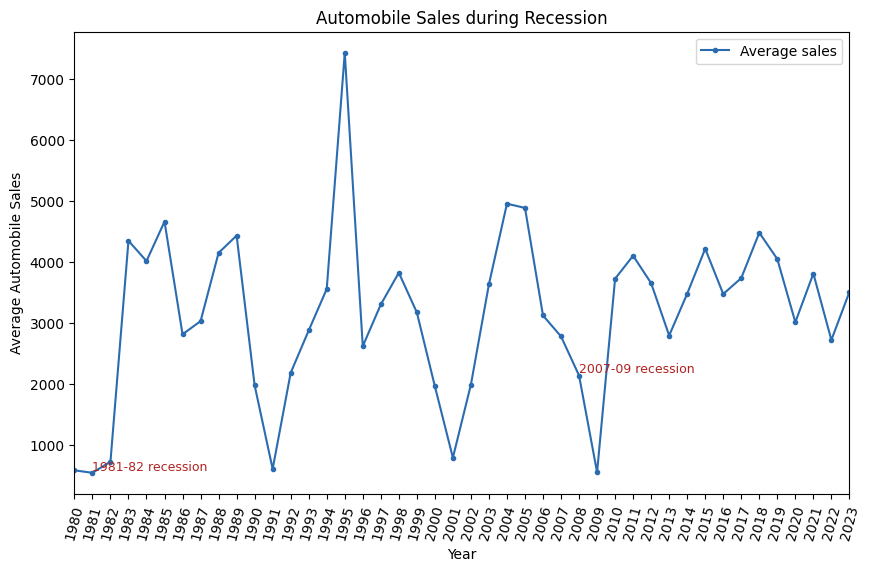
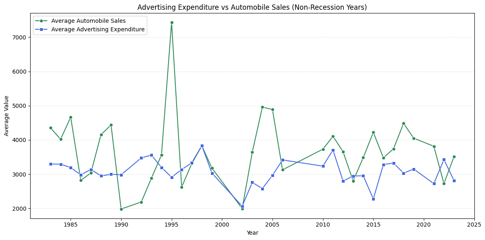
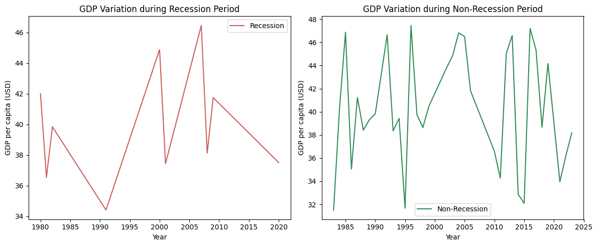

# Automobile Sales during Recessions — A Visual Analysis

How do automobile sales, advertising expenditure and consumer confidence behave
during US recession periods, and which vehicle segments absorb the shock?

## Dataset

- **Source:** `automobile-sales.csv`, distributed by IBM Skills Network for the
  *Data Visualization with Python* course
  (`https://cf-courses-data.s3.us.cloud-object-storage.appdomain.cloud/d51iMGfp_t0QpO30Lym-dw/automobile-sales.csv`)
- **Shape:** 2,112 monthly observations × 15 columns, covering 1980–2023
- **Fields used:** `Year`, `Month`, `Recession`, `Automobile_Sales`, `GDP`,
  `unemployment_rate`, `Consumer_Confidence`, `Seasonality_Weight`, `Price`,
  `Advertising_Expenditure`, `Vehicle_Type`
- **Usage permission:** the file is a *synthetic* teaching dataset created for the
  IBM course; it contains no real customer records. It is reused here solely for
  academic coursework, as the course permits.

Recession windows defined in the dataset:

| # | Period |
|---|--------|
| 1 | 1980 |
| 2 | 1981–1982 |
| 3 | 1991 |
| 4 | 2000–2001 |
| 5 | late 2007 – mid 2009 |
| 6 | Feb–Apr 2020 (COVID-19) |

## Methods and tools

- **Python 3.7** with `pandas` for filtering and aggregation
- `matplotlib` and `seaborn` for the static charts, `folium` for the map
- Analysis pattern: split the frame on the `Recession` flag → `groupby` the
  dimension of interest (`Year`, `Month`, `Vehicle_Type`, `unemployment_rate`)
  → aggregate with `mean()` or `sum()` → plot

## Key findings

1. **Sales fall in every recession window.** The deepest troughs are 2008–2009 and
   the 2020 COVID-19 quarter; the 1991 and 2001 dips are shallower but clearly visible.
2. **Advertising is cut defensively.** The large majority of total advertising
   expenditure happens outside recessions — spending is pulled back exactly when
   demand is weakest.
3. **The pain is uneven across vehicle types.** `ExecutiveCar` and `Sports` lose the
   largest share of their volume during downturns, while `SmallFamilyCar` and
   `MediumFamilyCar` hold up comparatively well — consistent with expensive,
   discretionary models being postponed first.
4. **GDP is lower and much more volatile during recessions** than in normal periods.
5. **Seasonality matters at the margin.** December (and to a lesser degree April)
   show the highest monthly volumes; seasonality weight alone does not explain the
   long-run trend.

## Limitation

The dataset is **synthetic**, so the relationships shown are descriptive rather than
causal, and no statistical significance test is performed. The charts answer
"what does the data look like", not "what caused it".

## How to run

```bash
pip install -r requirements.txt
jupyter notebook analysis.ipynb
```

The notebook downloads the CSV from the URL above on its first cell, so no local
data file is required. Run the cells top to bottom.

## Figures

**Average sales per year, recession windows annotated**



**Advertising expenditure vs sales, non-recession years**



**GDP in recession vs non-recession periods (subplots)**



## Repository layout

```
data-science-project/
├── analysis.ipynb          # full analysis, 10 tasks, executed with outputs
├── recession-sales.png
├── advertising-vs-sales.png
├── gdp-recession.png
├── requirements.txt
└── README.md
```
